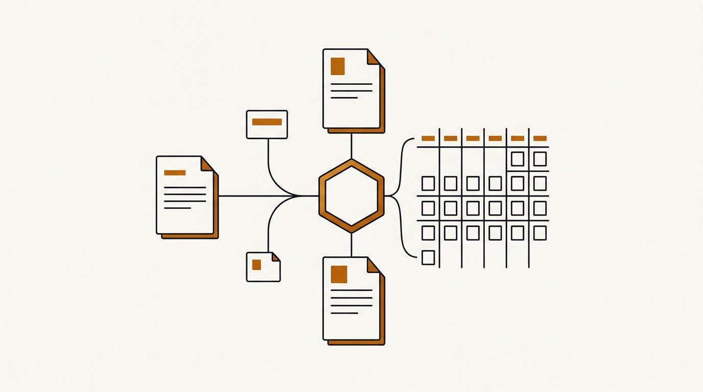
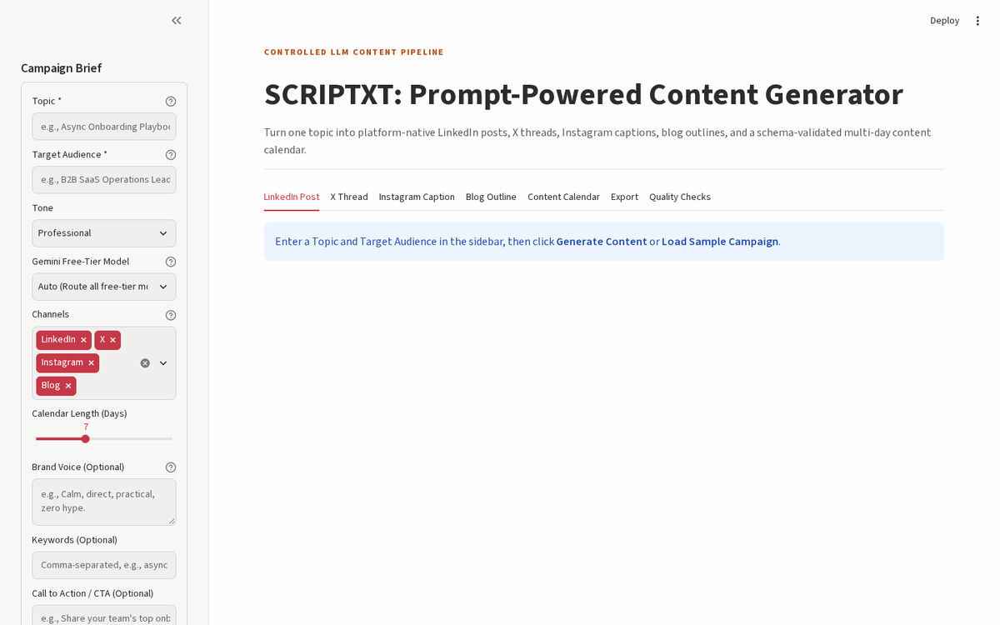
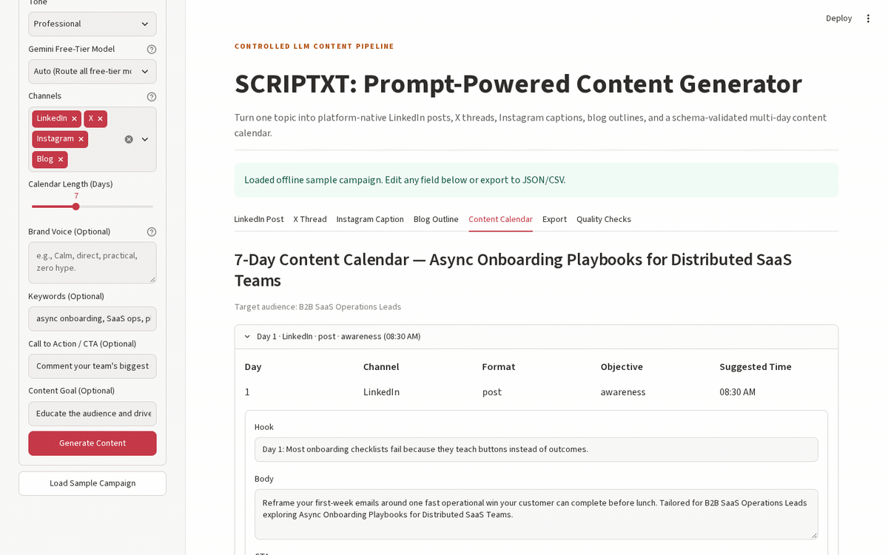
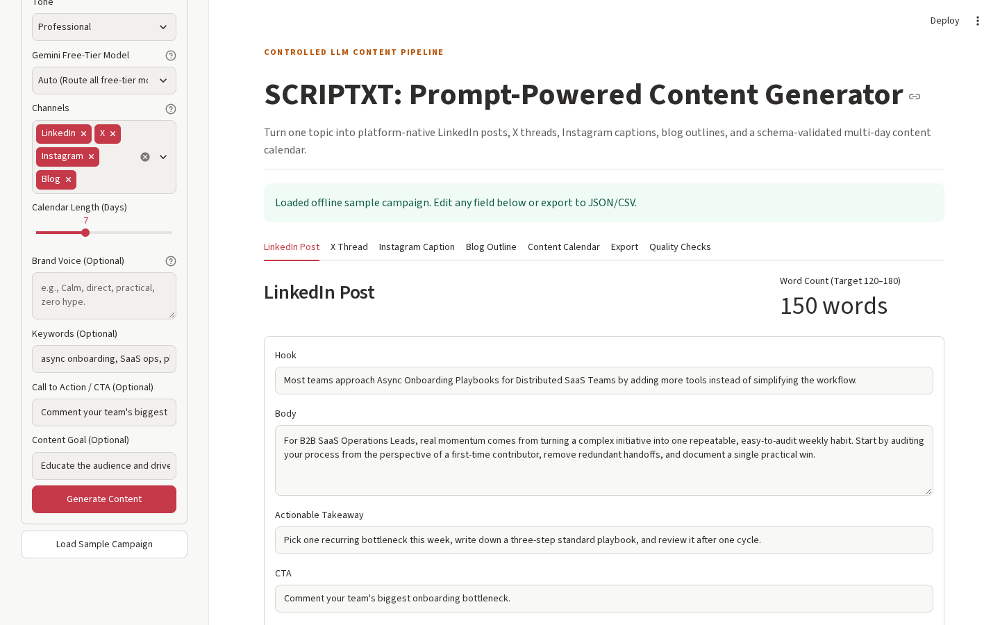
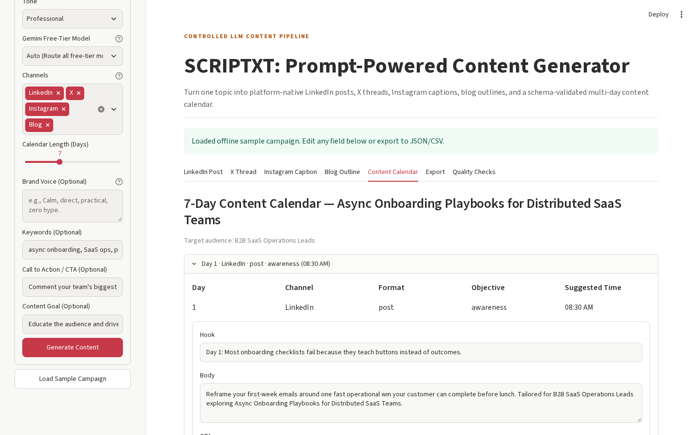
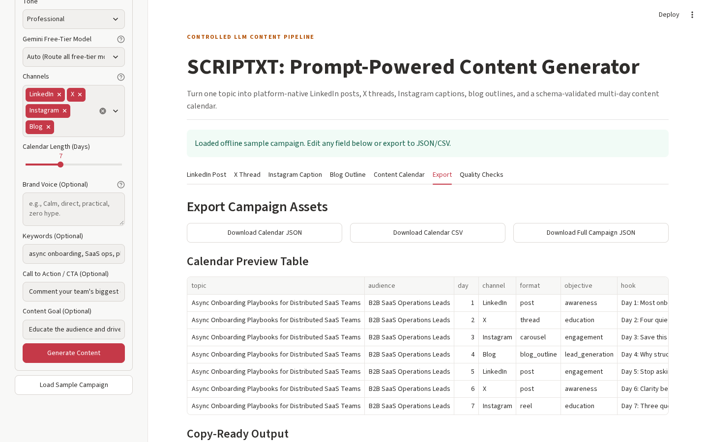
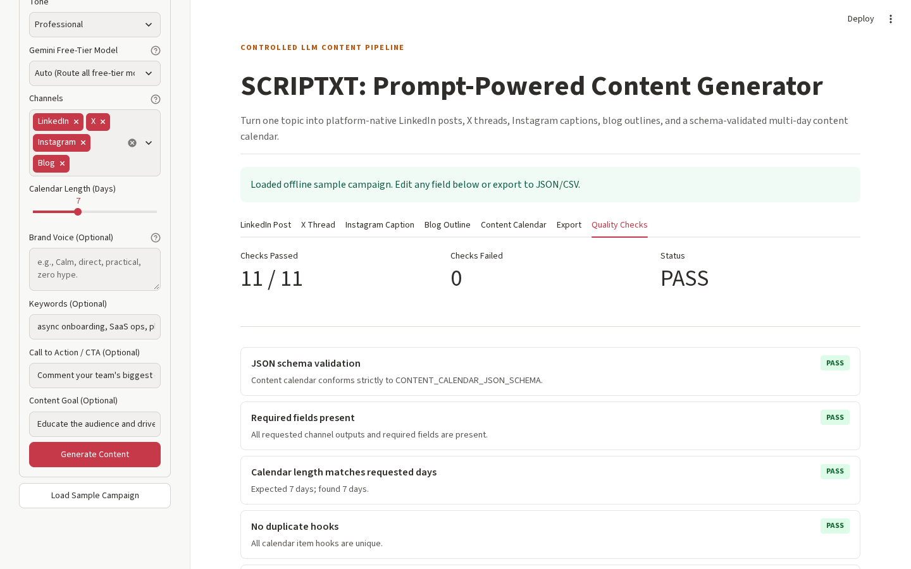

<p align="center">
  
</p>

<h1 align="center">SCRIPTXT: Prompt-Powered Content Generator</h1>

<p align="center">
  <strong>A controlled LLM content pipeline that turns one campaign topic into platform-native LinkedIn posts, X threads, Instagram captions, blog outlines, and a schema-validated multi-day content calendar.</strong>
</p>

<p align="center">
  <a href="https://scriptxt.streamlit.app/">
    
  </a>
  
  
  
</p>

<p align="center">
  <a href="https://scriptxt.streamlit.app/"><strong>Launch Live App →</strong></a> ·
  <a href="#interactive-walkthrough">Walkthrough</a> ·
  <a href="#screenshots">Screenshots</a> ·
  <a href="#architecture">Architecture</a> ·
  <a href="#setup-instructions">Setup</a>
</p>

---

## Live Deployment

Try **SCRIPTXT** live on Streamlit Community Cloud:
**[https://scriptxt.streamlit.app/](https://scriptxt.streamlit.app/)**

---

## Interactive Walkthrough

### 1. Topic to Multi-Channel Campaign & 7-Day Calendar
Fill out a single campaign brief in the sidebar and review, edit, check, and export every generated asset across seven dedicated tabs.



### 2. Live Editing & Automated Guardrails
Edit any generated post or calendar day directly in the UI—**Quality Checks** automatically re-runs to catch duplicate hooks, PII (emails, phone numbers, card-like numbers), placeholders, length limits, and unsupported claims.



---

## Screenshots

<table>
  <tr>
    <td width="50%">
      <strong>Campaign Workspace & LinkedIn Editor</strong><br />
      
    </td>
    <td width="50%">
      <strong>Editable 3–14 Day Content Calendar</strong><br />
      
    </td>
  </tr>
  <tr>
    <td width="50%">
      <strong>JSON & CSV Export with Table Preview</strong><br />
      
    </td>
    <td width="50%">
      <strong>Automated Quality & Safety Checks</strong><br />
      
    </td>
  </tr>
</table>

---

## Key Capabilities

- **Multi-Channel Generation**: Produces a 120–180 word LinkedIn post (with 3 hashtags), a 3–7 post X thread, an Instagram caption (< 2,200 chars) with accessibility alt text, a structured SEO blog outline, and a 3–14 day content calendar.
- **Free-Tier Gemini Multi-Model Routing**: Uses the `google-genai` Python SDK (`client.models.generate_content`) with `auto` mode routing across `gemini-4-hydrogen` and `gemini-3.1-flash-lite`, complete with automatic fallback on rate limits (`429`) or transient server errors.
- **Strict Structured Outputs**: Enforces JSON Schema contracts (`response_mime_type="application/json"` + `response_json_schema`) and validates every response with `jsonschema` and Pydantic v2.
- **Editable UI & Session Persistence**: Edit any generated asset or calendar item inside Streamlit tabs (`st.session_state`), with quality checks re-evaluated after every save.
- **Guardrails & Offline Evaluation**: Blocks invalid inputs (empty topic/audience, topic > 300 chars, brand voice > 1,000 chars, unsupported channels), flags unsafe outputs, and includes an offline evaluation harness (`evaluations/sample_topics.csv` + `evaluations/evaluation_rubric.md`).

---

## Architecture

```text
+-------------------------------------------------------------------+
|                        Streamlit UI (streamlit_app.py)            |
|  Sidebar Brief  |  7 Tabs: LinkedIn, X, IG, Blog, Calendar,       |
|  & Controls     |          Export, Quality Checks (st.session)    |
+--------+-----------------------------------+----------------------+
         |                                   |
         v                                   v
+------------------------+       +----------------------------------+
| Input Guardrails       |       | Exporters (exporters.py)         |
| (validators.py)        |       |  - JSON (strict calendar/suite)  |
|  - ContentRequest      |       |  - CSV (pandas DataFrame)        |
+--------+---------------+       +----------------------------------+
         |
         v
+------------------------+       +----------------------------------+
| Prompt Registry        |       | Strict JSON Schemas (schemas.py) |
| (prompts.py, versioned)|       |  - response_mime_type=json       |
+--------+---------------+       |  - response_json_schema          |
         |                       +----------------+-----------------+
         v                                        |
+-------------------------------------------------+-----------------+
| Generation Pipeline (generator.py & calendar.py)                  |
|  - Google Gemini API (`client.models.generate_content`)           |
|  - Parallel channel calls + free-tier model routing & fallback    |
+--------+----------------------------------------------------------+
         |
         v
+-------------------------------------------------------------------+
| Output Guardrails & Offline Evaluation (validators.py, eval)      |
|  - Schema validation, word/char limits, duplicate hook check      |
|  - Claim, PII, and placeholder detection                          |
+-------------------------------------------------------------------+
```

---

## Setup Instructions

### 1. Prerequisites

- Python **3.11+**
- A Gemini API key (`GEMINI_API_KEY`)

### 2. Install Dependencies

```bash
python3 -m venv .venv
source .venv/bin/activate
pip install -r requirements.txt
```

### 3. Configure Environment Variables

Copy `.env.example` to `.env` and add your Gemini API key:

```bash
cp .env.example .env
```

`.env`:

```env
GEMINI_API_KEY=your_api_key_here
GEMINI_MODEL=auto
```

> Never commit `.env` to version control (it is listed in `.gitignore`).

---

## Running the Applications

### Run the Streamlit Web App

```bash
streamlit run streamlit_app.py
```

1. Enter a **Topic** and **Target Audience** in the sidebar.
2. Choose **Tone**, **Gemini Free-Tier Model** (`Auto` or pinned model), **Channels**, and **Calendar Length** (`3–14` days).
3. Optionally add **Brand Voice**, **Keywords**, **CTA**, and **Content Goal**.
4. Click **Generate Content** (live Gemini API) or **Load Sample Campaign** (offline deterministic demo).
5. Edit any output in the tabs, verify **Quality Checks**, and download JSON/CSV via the **Export** tab.

### Run the CLI Entry Point

```bash
python app.py
```

### Run Unit Tests (Mocked LLM Calls)

```bash
pytest -v
```

### Run Offline Evaluation Harness

```bash
python -m scriptxt.evaluation
```

Reads `evaluations/sample_topics.csv`, runs generation and automated guardrail checks, and writes metrics to `evaluations/results.csv`. See `evaluations/evaluation_rubric.md` for the 1–5 human evaluation rubric.

---

## Example Input & Output

### Example Input

- **Topic**: `Async Onboarding Playbooks for Distributed SaaS Teams`
- **Target Audience**: `B2B SaaS Operations Leads`
- **Tone**: `Professional`
- **Channels**: `LinkedIn`, `X`, `Instagram`, `Blog`
- **Calendar Length**: `7` days
- **Keywords**: `async onboarding, SaaS ops, playbooks`
- **CTA**: `Comment your team's top onboarding bottleneck`

### Example Calendar JSON Item

```json
{
  "topic": "Async Onboarding Playbooks for Distributed SaaS Teams",
  "audience": "B2B SaaS Operations Leads",
  "calendar": [
    {
      "day": 1,
      "channel": "LinkedIn",
      "format": "post",
      "objective": "awareness",
      "hook": "Most onboarding checklists fail because they teach buttons instead of outcomes.",
      "body": "Reframe your first-week emails around one fast operational win your customer can complete before lunch.",
      "cta": "Comment your team's top onboarding bottleneck",
      "hashtags": ["#AsyncOnboarding", "#SaaSOps", "#Playbooks"],
      "suggested_time": "08:30 AM"
    }
  ]
}
```

---

## Limitations, Assumptions, and Safety Notes

- **API Dependency & Free-Tier Multi-Model Routing**: Live generation uses the `google-genai` Python SDK (`client.models.generate_content`) with `response_mime_type="application/json"` and `response_json_schema`. In `auto` mode (the default), SCRIPTXT routes tasks across active free-tier text models (`gemini-4-hydrogen` for LinkedIn posts, blog outlines, and multi-day calendars; `gemini-3.1-flash-lite` for fast X threads and Instagram captions) with automatic fallback if a model hits a rate limit or transient error.
- **Factual Verification**: Prompts instruct the model never to fabricate statistics, customer names, testimonials, or product claims, and to mark unverified claims with `[Needs verification]`. Human editorial review is still required before publishing.
- **Automated Guardrails Scope**: Built-in regex and schema checks catch common absolute claims, placeholder strings (`TODO`, `Lorem ipsum`), duplicate hooks, length violations, and obvious PII (emails, phone numbers, card-like sequences), but are not a substitute for brand or legal review.
- **No Medical, Legal, or Financial Advice**: System prompts explicitly prohibit medical, legal, financial, hateful, harassing, or impersonation outputs.
- **Local Session State**: Edits and generated outputs live in Streamlit's `st.session_state` for the active browser session; export JSON or CSV before closing if you want to keep a copy.
